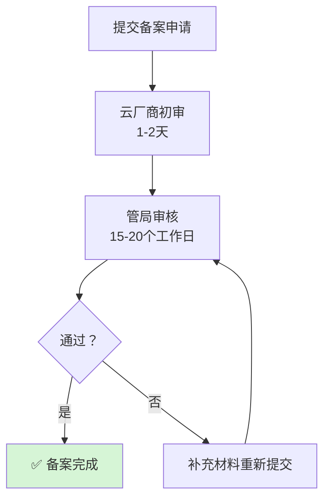

# 小程序上线全流程清单

> 适用：企业主体首次上线微信小程序
> 项目：校园生活平台（campus-life-miniapp）
> 编写日期：2026-10-26

---

## 一、整体时间线


**关键路径：域名备案 15-20 个工作日，必须最先启动。**

---

## 二、第一阶段：域名与服务器（第 1 天）

### 2.1 购买清单

| 项目 | 建议规格 | 参考价格 |
|---|---|---|
| 域名 | `.com` 或 `.com.cn` | 30-100 元/年 |
| 云服务器 | 腾讯云 4C4G 标准型 S5 | 200-350 元/月 |
| 系统盘 | SSD 100G | 含在内 |
| 带宽 | 5Mbps | 100-200 元/月 |
| SSL 证书 | 免费版（DV） | 0 元 |

> ⚠️ **服务器必须选「国内节点」**（北京/上海/广州），且**购买时长 ≥ 3 个月**，否则无法备案。

### 2.2 必须做的操作

- [ ] 域名实名认证（买完立刻做，1-3 天审核）
- [ ] 服务器选国内地域
- [ ] 服务器购买时长 ≥ 3 个月
- [ ] 记录服务器公网 IP

### 2.3 备案

**入口**：云厂商控制台的「ICP 备案」入口

**需要材料**：

| 材料 | 要求 |
|---|---|
| 营业执照 | 彩色扫描件，清晰 |
| 法人身份证 | 正反面 |
| 网站负责人身份证 | 可以是法人 |
| 幕布照片 | 云厂商会寄幕布，需拍照 |
| 核验单 | 在线签署 |

**流程**：



**备案期间可以做别的**（不影响）。

---

## 三、第二阶段：小程序账号（第 1-3 天，可与备案并行）

### 3.1 注册

**地址**：https://mp.weixin.qq.com

| 步骤 | 要点 |
|---|---|
| 1 | 点「立即注册」→ 选「小程序」 |
| 2 | 邮箱必须**未注册过微信公众平台**（不能和小程序/公众号重复） |
| 3 | 主体类型选「企业」 |
| 4 | 填营业执照信息、法人信息 |
| 5 | 验证方式选「对公打款」或「法人扫码」 |

**对公打款验证**：
- 微信向你公司账户打一笔 0.01-1 元的随机金额
- 在 **10 天内**回填这个金额
- 填错 3 次需重新申请

### 3.2 微信认证

| 项 | 说明 |
|---|---|
| 费用 | **300 元/年** |
| 时长 | 7-15 个工作日 |
| 不认证的后果 | 不能用微信支付、不能用部分能力 |

> **建议做认证**。没有认证，外卖支付功能跑不通。

### 3.3 拿到 AppID 后要改的配置

**① 小程序项目配置**：

```json
// project.config.json
{
  "appid": "wx1234567890abcdef"   // 换成你的真实 AppID
}
```

**② 后端配置**（`.env.local` 里填）：

```bash
CAMPUS_WX_APPID=wx1234567890abcdef
CAMPUS_WX_SECRET=你的AppSecret
```

> AppSecret 在「开发管理 → 开发设置」里生成，**只显示一次**，务必保存好。

---

## 四、第三阶段：服务器部署（第 20 天左右，备案通过后）

### 4.1 环境安装

```bash
# JDK 21
sudo apt update
sudo apt install -y openjdk-21-jdk

# MySQL 8
sudo apt install -y mysql-server

# Nginx
sudo apt install -y nginx

# Node.js（构建 Web 端用）
curl -fsSL https://deb.nodesource.com/setup_20.x | sudo -E bash -
sudo apt install -y nodejs
```

### 4.2 数据库初始化

```bash
# 创建数据库
mysql -uroot -p -e "CREATE DATABASE campus_life DEFAULT CHARACTER SET utf8mb4 COLLATE utf8mb4_unicode_ci;"

# 建专用账号（不要用 root）
mysql -uroot -p -e "
CREATE USER 'campus_user'@'localhost' IDENTIFIED BY '<强密码>';
GRANT ALL ON campus_life.* TO 'campus_user'@'localhost';
FLUSH PRIVILEGES;"

# 导入表结构与数据
mysql -ucampus_user -p campus_life < backend/src/main/resources/db/schema.sql
mysql -ucampus_user -p campus_life < backend/src/main/resources/db/module-perf-index.sql
```

### 4.3 MySQL 优化（4C4G 机器关键）

编辑 `/etc/mysql/my.cnf`：

```ini
[mysqld]
innodb_buffer_pool_size = 512M
performance_schema = OFF
max_connections = 200
wait_timeout = 1800
character-set-server = utf8mb4
```

```bash
sudo systemctl restart mysql
```

### 4.4 后端部署

```bash
# 上传 jar
scp backend/target/campus-life-api-1.0.0.jar user@server:/opt/campus/

# 复制环境变量
scp .env.local user@server:/opt/campus/

# 启动脚本 /opt/campus/start.sh
```

`start.sh` 内容：

```bash
#!/bin/bash
cd /opt/campus
set -a; source .env.local; set +a
nohup java -Xms1536m -Xmx1536m \
  -XX:+UseG1GC -XX:MaxMetaspaceSize=256m \
  -XX:+HeapDumpOnOutOfMemoryError \
  -jar campus-life-api-1.0.0.jar \
  > /var/log/campus/app.log 2>&1 &
echo $! > /var/log/campus/app.pid
```

### 4.5 Nginx 配置

`/etc/nginx/sites-available/campus`：

```nginx
upstream campus_backend {
    server 127.0.0.1:8080;
    keepalive 64;
}

server {
    listen 80;
    server_name your-domain.com;
    return 301 https://$host$request_uri;
}

server {
    listen 443 ssl http2;
    server_name your-domain.com;

    ssl_certificate     /etc/nginx/ssl/your-domain.com.crt;
    ssl_certificate_key /etc/nginx/ssl/your-domain.com.key;

    client_max_body_size 10M;

    # Web 管理端静态资源
    location / {
        root /opt/campus/web;
        try_files $uri $uri/ /index.html;
    }

    # 后端 API
    location /api/ {
        proxy_pass http://campus_backend;
        proxy_http_version 1.1;
        proxy_set_header Host $host;
        proxy_set_header X-Real-IP $remote_addr;
        proxy_set_header X-Forwarded-For $proxy_add_x_forwarded_for;
        proxy_set_header Connection "";
    }

    # WebSocket 群聊（必须配 Upgrade 头）
    location /ws/ {
        proxy_pass http://campus_backend;
        proxy_http_version 1.1;
        proxy_set_header Upgrade $http_upgrade;
        proxy_set_header Connection "upgrade";
        proxy_set_header Host $host;
        proxy_read_timeout 3600s;
    }

    # 上传的文件
    location /uploads/ {
        proxy_pass http://campus_backend;
    }
}
```

### 4.6 SSL 证书

```bash
# 用 Let's Encrypt 免费证书
sudo apt install -y certbot python3-certbot-nginx
sudo certbot --nginx -d your-domain.com
```

---

## 五、第四阶段：小程序配置（第 21 天）

### 5.1 配置服务器域名

**路径**：mp.weixin.qq.com → 开发管理 → 开发设置 → 服务器域名

| 类型 | 填什么 |
|---|---|
| request 合法域名 | `https://your-domain.com` |
| uploadFile 合法域名 | `https://your-domain.com` |
| downloadFile 合法域名 | `https://your-domain.com` |
| socket 合法域名 | `wss://your-domain.com` |

**要求**：
- 必须是 **HTTPS**（不能用 http）
- 必须**已备案**
- 不能带端口号

### 5.2 修改前端请求地址

检查小程序里的 API 基址配置：

```javascript
// utils/api.js 或 config.js
const BASE_URL = 'https://your-domain.com'   // 从 127.0.0.1 改成真实域名
```

管理端同理：

```javascript
// web/.env.production
VITE_API_BASE=https://your-domain.com
```

### 5.3 真机测试

- [ ] 用真机扫码预览
- [ ] 所有页面能正常打开
- [ ] 图片能加载（上传的文件可访问）
- [ ] 群聊 WebSocket 能连上
- [ ] 外卖下单流程完整

---

## 六、第五阶段：微信支付（第 22-24 天）

### 6.1 申请

**路径**：小程序后台 → 功能 → 微信支付 → 开通

| 材料 | 说明 |
|---|---|
| 营业执照 | 与小程序主体一致 |
| 法人身份证 | 正反面 |
| 对公账户 | 用于结算 |
| 经营类目 | 餐饮/零售等，按实际选 |

### 6.2 获取参数

**微信支付商户平台**：https://pay.weixin.qq.com

路径：账户中心 → API 安全

| 参数 | 在哪 |
|---|---|
| `mch-id` | 商户号，首页可见 |
| `api-v3-key` | APIv3 密钥（自己设置的 32 位） |
| `cert-serial-no` | 商户证书序列号 |
| `private-key-path` | 下载的 `apiclient_key.pem` 路径 |
| `app-id` | 与小程序 AppID 相同 |

### 6.3 上线支付配置

```bash
# .env.local
WXPAY_ENABLED=true
WXPAY_APP_ID=wx1234567890abcdef
WXPAY_MCH_ID=1600000000
WXPAY_API_V3_KEY=你的32位密钥
WXPAY_CERT_SERIAL_NO=你的证书序列号
WXPAY_PRIVATE_KEY_PATH=/opt/campus/cert/apiclient_key.pem
WXPAY_NOTIFY_URL=https://your-domain.com/api/pay/notify
WXPAY_REFUND_NOTIFY_URL=https://your-domain.com/api/pay/refund/notify
CAMPUS_PAY_SIMULATE=false
```

**重启后端**，然后在商户平台配置支付回调域名。

### 6.4 支付测试

- [ ] 下单 → 拉起支付 → 支付成功
- [ ] 订单状态变 `paid`
- [ ] 商家接单
- [ ] 骑手抢单 → 取餐 → 送达
- [ ] 申请退款 → 退款到账

> ⚠️ **真实资金测试建议用 0.01 元商品**，避免大额扣款。

---

## 七、第六阶段：提交审核（第 25 天）

### 7.1 审核前自查

| # | 检查项 | 结果 |
|---|---|---|
| 1 | 小程序名称、简介、类目填写完整 | ☐ |
| 2 | 所有页面无白屏、无报错 | ☐ |
| 3 | 图片全部能加载 | ☐ |
| 4 | 没有「测试」「demo」字样 | ☐ |
| 5 | 没有无效页面入口 | ☐ |
| 6 | 隐私政策已配置 | ☐ |
| 7 | 用户协议已配置 | ☐ |
| 8 | 没有诱导分享 | ☐ |
| 9 | 内容审核机制已生效 | ☐ |

### 7.2 常见驳回原因

| 原因 | 怎么避免 |
|---|---|
| **类目不符** | 外卖类和社交类要分开申请，或选「生活服务」 |
| **功能不完整** | 不要留「敬请期待」的空白页 |
| **内容审核缺失** | UGC 内容必须有审核机制（你已有敏感词） |
| **无隐私政策** | 后台必须配置 |
| **支付类目问题** | 有支付功能必须选对应类目 |

### 7.3 提交

**路径**：开发管理 → 开发版本 → 提交审核

- 填写版本号（如 1.0.0）
- 填写功能描述（写清楚每个页面的作用）
- 上传测试账号（如果有登录）

**审核时长**：1-7 个工作日，通常 1-3 天。

---

## 八、第七阶段：上线后

### 8.1 发布

审核通过后 → 点击「发布」→ 全量发布。

### 8.2 监控

| 项目 | 阈值 | 工具 |
|---|---|---|
| 服务器 CPU | > 80% | 云监控 |
| 内存 | > 85% | 云监控 |
| 磁盘 | > 80% | 云监控 |
| 接口错误率 | > 1% | 日志 |
| 支付失败率 | > 2% | 日志 |

### 8.3 备份

```bash
# 每天凌晨 3 点自动备份数据库
# crontab -e 添加：
0 3 * * * mysqldump -ucampus_user -p<密码> campus_life | gzip > /backup/db_$(date +\%Y\%m\%d).sql.gz
```

---

## 九、费用总览

| 项目 | 费用 | 周期 |
|---|---|---|
| 域名 | 30-100 元 | 年 |
| 服务器 4C4G | 200-350 元 | 月 |
| 带宽 5M | 100-200 元 | 月 |
| 小程序认证 | 300 元 | 年 |
| 微信支付 | 0.6% 手续费 | 按交易 |
| SSL 证书 | 0 元（免费版） | 年 |
| **首年合计** | **约 4000-6000 元** | |

---

## 十、常见问题

**Q：备案要多久？能不能快点？**

A：法定 20 个工作日，实际 15-20 天。加急服务通常不靠谱。**唯一的办法是早点提交**。

**Q：没有对公账户能注册吗？**

A：可以选「法人扫码验证」，需要法人微信已实名。但**微信支付必须对公账户**。

**Q：小程序和公众号必须同主体吗？**

A：**必须**。否则无法在公众号里跳转小程序，也无法用同一支付商户号。

**Q：先用个人主体上线，后面能改企业吗？**

A：**不能**。个人主体无法变更为企业主体，只能重新注册。**一开始就用企业主体**。

**Q：测试期间能用什么替代？**

A：开发者工具里用 `touristappid` 就能跑所有前端逻辑，只是不能真机预览和支付。**开发阶段完全够用**。

---

## 十一、当前项目需要改的地方

| 文件 | 改什么 |
|---|---|
| `project.config.json` | `appid` 改成真实 AppID |
| `.env.local` | 按 [.env.example](.env.example) 填真实值 |
| `utils/api.js` | BASE_URL 改成真实域名 |
| `web/.env.production` | `VITE_API_BASE` 改成真实域名 |
| 小程序后台 | 配置服务器域名白名单 |
| 微信支付商户平台 | 配置支付回调域名 |

---

## 附：检查清单速查

### 备案通过后立即做

- [ ] 配置 SSL 证书
- [ ] 部署后端
- [ ] 部署 Web 管理端
- [ ] Nginx 配置（含 WebSocket）
- [ ] 小程序服务器域名白名单
- [ ] 改前端 BASE_URL
- [ ] 真机测试

### 提交审核前必做

- [ ] 隐私政策
- [ ] 用户协议
- [ ] 类目正确
- [ ] 无空白页
- [ ] 无测试字样
- [ ] 内容审核生效
